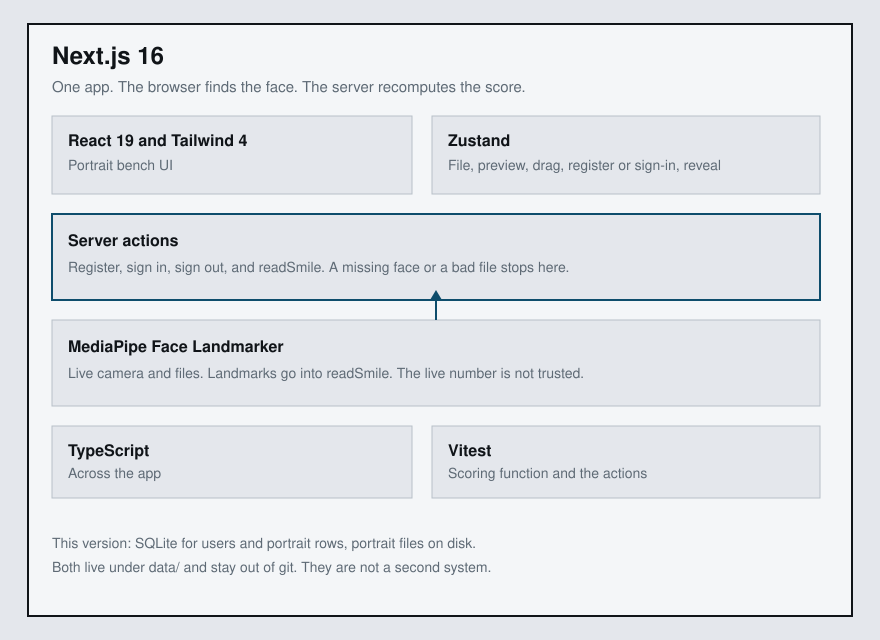
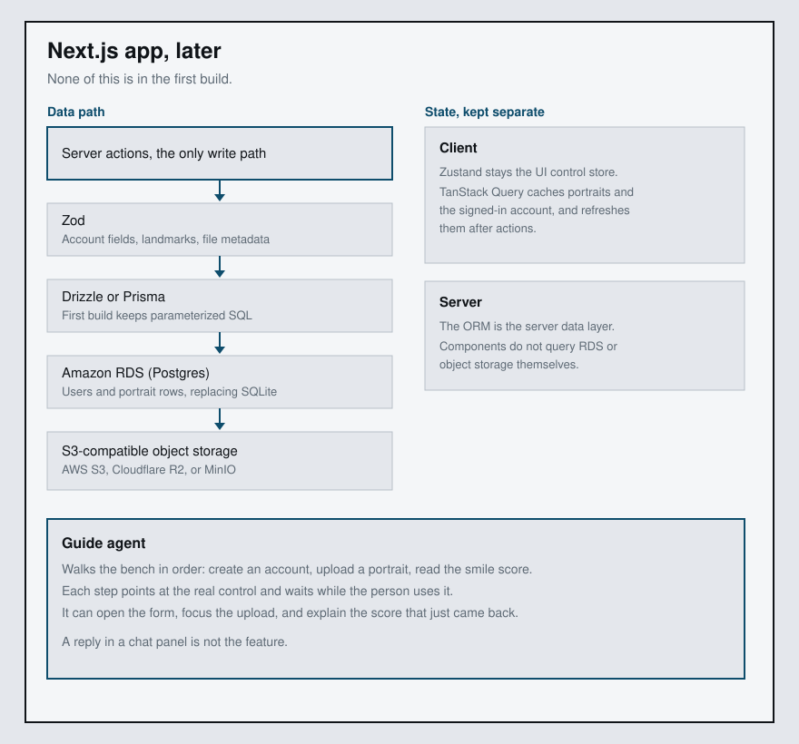

# Portrait bench

Register, upload a portrait, and read a smile score. This version is a Next.js app. The browser finds the face. The server recomputes the score from the landmarks and stores the portrait.

## Architecture

The editable board is [docs/architecture.excalidraw](docs/architecture.excalidraw).

SQLite and the portrait files on disk sit under that app as the stand-in for this version. They live in `data/`, which is gitignored. A missing face or a bad file stops in the server action and never reaches storage.

Run it with `npm run dev`. Tests are `npm test`.

On Netlify, set `SESSION_SECRET` in the site environment. `/` sends you to `/login`. SQLite and portraits use `data/` locally, or a temp directory if that folder is not writable.

## Assumptions

- Local SQLite and disk files stand in for a hosted database and object storage.
- The browser finds the face with MediaPipe Face Landmarker. The model and WASM files are vendored in `public/models` so the demo does not need a live CDN.
- The server does not trust a client-sent score. It checks the landmark payload and recomputes the 0–100 score.
- One account can have many portraits.
- A portrait must be a jpeg, png, or webp, sniffed from the file bytes, and at most 5 MB.
- Zod, an ORM, Amazon RDS, object storage, TanStack Query, and the guide agent are next steps. They are not behavior of this version.

## Next steps

The editable board is [docs/future-architecture.excalidraw](docs/future-architecture.excalidraw).

Server actions stay the only write path. Zod checks account fields, the landmark payload, and file metadata before any write. Drizzle or Prisma sits between those actions and the database. Amazon RDS (Postgres) replaces SQLite for users and portrait rows. S3-compatible object storage (AWS S3, Cloudflare R2, or MinIO) replaces local files.

Client UI state and server data stay separate. Zustand remains the UI control store. TanStack Query caches portraits and the signed-in account and refreshes them after actions. The ORM is the server data layer. Components do not query RDS or object storage themselves.

The guide agent lives inside the Next.js app. It walks the bench in order: create an account, upload a portrait, read the smile score. Each step points at the real control and waits while the person uses it. The agent can open the form, focus the upload, and explain the score that just came back.

## With more time

The future diagram carries state, Zod, the ORM, RDS, object storage, and the guide agent. It does not show four further pieces: server-side face detection so landmarks cannot be forged, upload rate limits, password reset, and calibrating the 0–100 score against labeled portraits.
